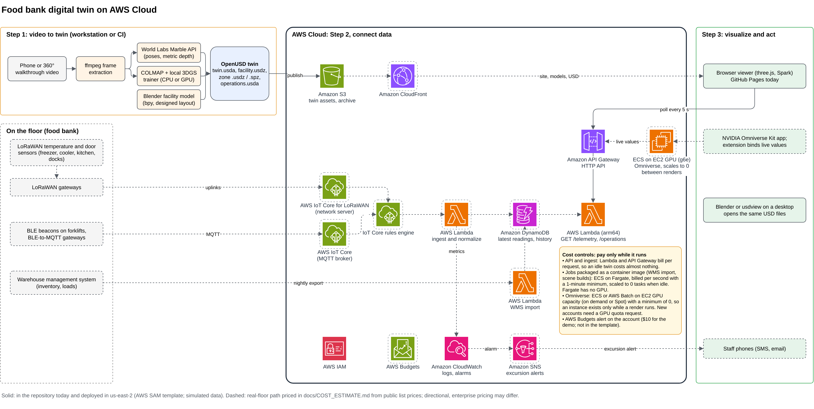
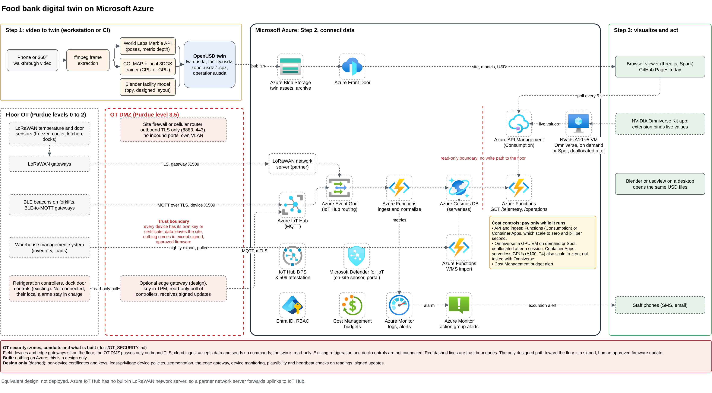
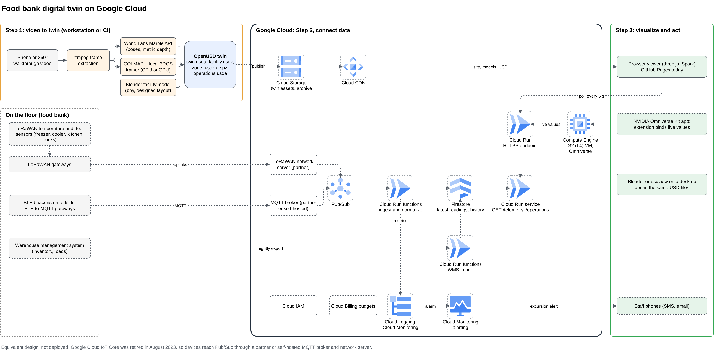

# From video to digital twin, with no CAD

This repository builds a working digital twin of a food bank from a publicly available news video. It runs three steps end to end:

1. **Video to world model.** Frames from the video go to the World Labs Marble world model (camera poses, metric depth) and to a local 3D Gaussian Splatting trainer. The result is a set of splat captures in OpenUSD.
2. **Blender for the 3D facility.** A headless Blender script models the whole building, the parts the video never showed included, from the facility's own footprints. No CAD drawings, laser scans or site visits are used.
3. **Omniverse and the browser as the digital twin.** AWS serves live (today simulated) telemetry and operations data in the same metric frame, and the twin is viewed in a browser on GitHub Pages, in NVIDIA Omniverse on a rented GPU, or in Blender. OpenUSD is the open contract between all three steps.

It was built in seven days (2026-10-19 to 2026-10-25) for **$0.20 of confirmed world-model credits**, **$0.00 of AWS backend charges** and **about $1.34 of GPU time** for the Omniverse trials. The point is that existing tools are now good enough to stand up a useful twin from footage that already exists, much faster and cheaper than a CAD-first project.

**Live demo:** <https://pikulsomesh.github.io/foodbank-spatial-twin/> · **Docs wiki:** <https://pikulsomesh.github.io/foodbank-spatial-twin/wiki/> · **Cost page:** <https://pikulsomesh.github.io/foodbank-spatial-twin/wiki/cost.html>

**Pitch video:** [full cut (23 s)](https://pikulsomesh.github.io/foodbank-spatial-twin/media/foodbank-twin-pitch-long.mp4) · [short cut (16 s)](https://pikulsomesh.github.io/foodbank-spatial-twin/media/foodbank-twin-pitch-16s.mp4) (files in [public/media/](public/media/)). The Omniverse shots in it are real RTX renders of the Blender-modeled facility; the splats are shown in the browser viewer, not in Omniverse.

> **What this is, honestly.** The twin is a **representative food bank inspired by the Central Texas Food Bank**, not a model of any one site. The source video is a publicly available tour by 25 News KXXV; neither KXXV nor the Central Texas Food Bank was involved in this work or has endorsed it. Every part of the twin is labeled as captured, designed, published, estimated or simulated (see [Provenance](#provenance)). Cost figures are directional: they come from public list prices and what one individual AWS account could access, and enterprise discounts, quotas and policies may differ.

## This is a real deployment, not a mock-up

| Part | Status | Where |
|---|---|---|
| World-model captures | **Ran** on World Labs Marble 2 (3 zones, 200 credits) | [docs/CTFB_WAREHOUSE_RUN.md](docs/CTFB_WAREHOUSE_RUN.md) |
| Photoreal splats trained from the video | **Ran** locally for 4 zones (0 credits) | [docs/PHOTOREAL.md](docs/PHOTOREAL.md) |
| Blender facility model | **Built** by `scripts/build_facility.py`, published as GLB and USDZ | [docs/VIEWER.md](docs/VIEWER.md) |
| AWS backend | **Deployed** in us-east-2: S3, API Gateway HTTP API, Lambda (AWS SAM) | [docs/BACKEND.md](docs/BACKEND.md) |
| Browser twin | **Live** on GitHub Pages, reading the AWS API | [live site](https://pikulsomesh.github.io/foodbank-spatial-twin/) |
| Omniverse on an AWS GPU (EC2 g6.xlarge / g5.xlarge) | **Rendered (facility only)**: seven runs on real AWS GPU instances (about 94 instance-minutes, about $1.34, each terminated after). Omniverse RTX rendered the designed facility on runs 6 and 7, including 4 s clips of the forklift driving; the Gaussian-splat captures loaded but rendered blank, so Omniverse rendering of the splats is not shown. Every pitfall is in [docs/OMNIVERSE_LEARNINGS.md](docs/OMNIVERSE_LEARNINGS.md) | [docs/RENDERING.md](docs/RENDERING.md) |
| Real sensors on a food bank floor | **Designed and priced**, not installed (dashed in the diagram) | [docs/COST_ESTIMATE.md](docs/COST_ESTIMATE.md) |

Live API: <https://f2ck9o1rx0.execute-api.us-east-2.amazonaws.com/telemetry> and [`/operations`](https://f2ck9o1rx0.execute-api.us-east-2.amazonaws.com/operations). Its data is simulated, and every payload says so (`simulated: true`).

## Solution architecture

The AWS diagram is the reference architecture. **Solid** borders are implemented in this repository today (the SAM template, with simulated data); **dashed** borders are the real-floor path, designed and priced in the cost estimate. Each diagram has a cost-controls panel: everything bills only while it runs.



The same design maps onto Azure and Google Cloud. **These two are designs only and have never been deployed.** Azure IoT Hub has no LoRaWAN network server, so it needs a partner server; Google Cloud IoT Core was retired in August 2023.

| Azure (design only) | Google Cloud (design only) |
|---|---|
|  |  |

Editable draw.io sources: [AWS](paper/diagrams/arch_aws.drawio), [Azure](paper/diagrams/arch_azure.drawio), [Google Cloud](paper/diagrams/arch_gcp.drawio). They are generated by [`paper/diagrams/make_diagrams.py`](paper/diagrams/make_diagrams.py). See [docs/ARCHITECTURE.md](docs/ARCHITECTURE.md) for the contracts between steps.

## How it works

```
 STEP 1  Video -> world model -> OpenUSD captures         scripts/atlas_twin.py, scripts/photoreal_twin.py
   news video (MP4) -> ffmpeg frames, people masked
     -> World Labs Marble 2: images2PosedRGBD (poses + metric depth) -> local RGBD fusion -> zone .spz / .usdz
     -> COLMAP + local 3DGS trainer (CPU or GPU)                    -> photoreal zone .spz / .usdz

 STEP 1b Blender facility model                            scripts/build_facility.py
   footprints from the operations master data -> headless bpy -> facility.glb (browser) + facility.usdz (Omniverse)

                         OpenUSD contract: twin.usda (Y-up, metres, floor at y = 0)
                         = facility.usdz + captures (placed and cropped) + operations.usda

 STEP 2  Data on AWS                                       template.yaml, src/telemetry/
   S3 + API Gateway HTTP API + Lambda: GET /telemetry, GET /operations, same metric frame
   today simulated; real path: LoRaWAN and BLE sensors -> IoT Core -> Lambda -> DynamoDB

 STEP 3  Visualize                                          public/, docs/RENDERING.md
   browser (three.js + Spark, GitHub Pages)  |  Omniverse Kit on an EC2 GPU  |  Blender / usdview
```

| Step | Guide |
|---|---|
| Original single-call world-model pipeline and its cost guards | [docs/PIPELINE.md](docs/PIPELINE.md) |
| The run on the news video: zones, frames, Marble 2 route | [docs/CTFB_WAREHOUSE_RUN.md](docs/CTFB_WAREHOUSE_RUN.md) |
| Photoreal splats trained from the video | [docs/PHOTOREAL.md](docs/PHOTOREAL.md) |
| AWS backend and the deployed instance | [docs/BACKEND.md](docs/BACKEND.md) |
| Operations, inventory and supply-chain layer | [docs/OPERATIONS.md](docs/OPERATIONS.md) |
| Browser viewer | [docs/VIEWER.md](docs/VIEWER.md) |
| Rendering in Blender and Omniverse | [docs/RENDERING.md](docs/RENDERING.md) |
| Omniverse on AWS: every GPU run, what failed, what fixed it | [docs/OMNIVERSE_LEARNINGS.md](docs/OMNIVERSE_LEARNINGS.md) |
| Cost estimate | [docs/COST_ESTIMATE.md](docs/COST_ESTIMATE.md) |

The same pages, laid out as a wiki, are on the demo site at [`/wiki/`](https://pikulsomesh.github.io/foodbank-spatial-twin/wiki/).

## Run it

```bash
# Tests (what CI runs)
python -m pip install pytest && pytest -q tests && node --test tests/*.test.mjs

# View the twin locally
python -m http.server -d public 8000          # open http://localhost:8000

# Step 1: world-model capture (paid; resumes instead of re-paying)
python3.12 -m venv .venv && .venv/bin/pip install -r requirements.txt numpy scipy OpenEXR
export WLT_API_KEY=...                         # never commit keys
.venv/bin/python scripts/atlas_twin.py pose
.venv/bin/python scripts/atlas_twin.py fuse

# Step 1, free: photoreal splats trained locally (see docs/PHOTOREAL.md for every stage)
.venv/bin/python scripts/photoreal_twin.py frames --zone racking --video path/to/tour.mp4

# Step 1b: Blender facility model (Python 3.13, pip install bpy pillow numpy)
python scripts/build_facility.py

# OpenUSD twin for Omniverse
pip install -r requirements-render.txt
python scripts/operations_to_usd.py && python scripts/align_twin_usd.py   # writes public/twin.usda

# Step 2: deploy the AWS backend (SAM CLI and AWS credentials; defaults to us-east-2)
scripts/deploy.sh
```

## Cost

| | Cost |
|---|---|
| This build (world model, local training, Blender, AWS, GPU trials) | **about $1.54** ($0.20 credits confirmed, $1.34 GPU at list price); at most $2.34 |
| Capture to deployed twin for a full ~135,000 sq ft facility | about **$25 to $50** of cloud spend (directional) |
| Running it on real sensors | about **$2,700** hardware once, about **$12 a month** on AWS |
| Omniverse on demand, 10 hours a week | about **$124 a month** (Marketplace g6e.xlarge) |

Details, assumptions and sources: [docs/COST_ESTIMATE.md](docs/COST_ESTIMATE.md) and the [cost page](https://pikulsomesh.github.io/foodbank-spatial-twin/wiki/cost.html). Figures use public list prices checked 2026-10-19 and an individual AWS account; they are directional, not a quote.

## Provenance

| Part of the twin | Kind | Source |
|---|---|---|
| Racking aisle, sorting room, client market | Captured, partial | Frames of the public news tour; world-model depth fused locally, and trained locally as 3DGS |
| Community kitchen interior | Captured, partial | Trained locally from frames of the same video; no world-model capture |
| Absolute scale | Estimated | The world model's metric depth; not checked against a survey |
| Building shell, receiving, freezer, cooler, order staging, kitchen annex | Designed | Footprints chosen for this project |
| Modeled facility (racking, cold rooms, sorting lines, market, kitchen equipment, forklifts) | Designed | Built in Blender by one script, fit-out inspired by the video |
| Annual volume, agencies, floor area, pallet positions, docks, meals per day | Published | Central Texas Food Bank's public figures for its Austin facility |
| Shares, product mix, capacities, recipes, step times | Estimated | Flagged `est: true` in the master data |
| Temperatures, doors, forklifts, daily flows, inventory | Simulated | Computed from the clock; every payload carries `simulated: true` |

## Repository map

```
scripts/        step 1 pipelines (atlas_twin, photoreal_twin, splat_train, world_labs_to_usd),
                build_facility (Blender), align_twin_usd + operations_to_usd (OpenUSD), deploy.sh, renderers
data/           frames, masks and layout used for the published run
template.yaml   step 2, AWS SAM
src/telemetry/  step 2 Lambda (telemetry and operations simulators)
public/         step 3 browser twin, published assets, and the docs wiki (public/wiki/)
paper/          LaTeX paper and the draw.io architecture diagrams
docs/           the engineering guides linked above
tests/          Python and Node tests, run by .github/workflows/pages.yml
```

## Paper

*From Video to Digital Twin: Accelerating Spatial Twins with World Models and NVIDIA Omniverse*, Somesh Mohapatra. LaTeX source in [`paper/`](paper/).
