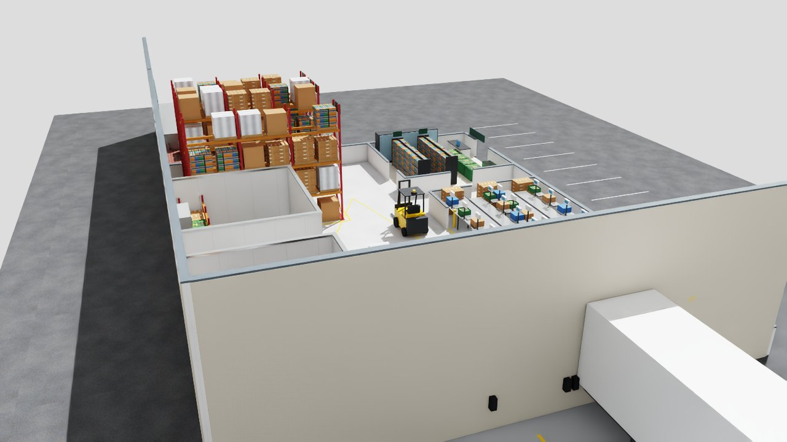
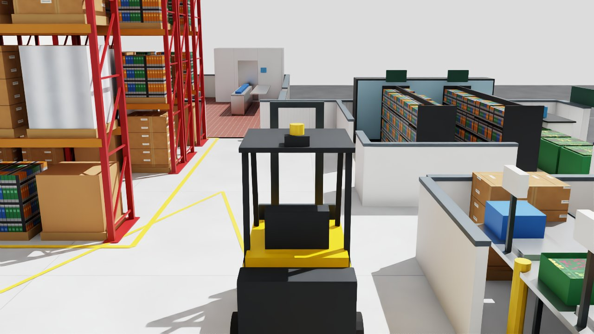

# Omniverse on AWS: learnings and pitfalls

What happened when we tried to render the twin in NVIDIA Omniverse on a rented AWS GPU, run by run. It covers what failed, why it failed and what fixed it, so the next person can skip the dead ends. Scripts: `scripts/gpu_trial.py` (launch, render, upload, self-terminate), `scripts/omniverse_render_shots.py` (stills) and `scripts/omniverse_render_clips.py` (4 s moving clips). Full logs are in `docs/renders/omniverse-trial/`.

Costs are worked out from the public on-demand list price ($0.8048 an hour for g6.xlarge in us-east-2) on one individual AWS account. They are directional; enterprise accounts may see different prices, quotas and policies.

## Short version

**Result:** Omniverse (Kit 107.3 in Isaac Sim 5.1) rendered the designed Blender facility in RTX on run 6, and on run 7 rendered three 4 s clips with the forklift driving through the building. The Gaussian-splat captures loaded but rendered blank grey, so Omniverse rendering of the splats is **not** shown. Total GPU time across seven runs was about 94 instance-minutes, about $1.34 at list price.





- **Use the driver branch Isaac Sim is validated on.** Isaac Sim 5.1 (Kit 107.3) crashed a second after start on the AWS Deep Learning AMI's 595 driver, even with an empty scene. It started cleanly on plain Ubuntu 22.04 with `nvidia-driver-580-server` (580.178.04).
- **Test with a cube before your scene.** A one-cube stage separates "the GPU stack is broken" from "my USD file is broken". It took four runs to learn that the twin files were never the problem.
- **Budget about 12 minutes before the first frame.** On a cold instance that is about 1 min to boot, about 4.5 min to pull the Isaac Sim image, and about 5 min for Kit to build its shader cache on first start. Render everything in one session.
- **New AWS accounts have 0 GPU quota.** Request "Running On-Demand G and VT instances" vCPUs early (4 is enough for one g6.xlarge). Ours was escalated, approved after about an hour, and took another 30 minutes or so to apply.
- **Have a fallback instance type.** On run 7 no us-east-2 zone had g6.xlarge capacity; g5.xlarge (NVIDIA A10G, $1.006 an hour) ran the same setup unchanged.
- **Make the instance unable to outlive the job.** No SSH key, no IAM role, inputs and outputs through presigned S3 URLs, `shutdown -h +N` as a hard cap, and shutdown behaviour set to terminate.

## The setup

| Part | Choice | Why |
|---|---|---|
| Instance | `g6.xlarge`: 1× NVIDIA L4 (24 GB), 4 vCPU, 16 GB RAM | Cheapest current RTX-class GPU on EC2 that fits a 4-vCPU quota |
| Region | us-east-2 | The account's organisation policy blocks us-east-1 and us-west-2 |
| Omniverse | `nvcr.io/nvidia/isaac-sim:5.1.0` container (Kit 107.3), headless, `./python.sh` script | Ready-made Kit with RTX; no build step. Needs `ACCEPT_EULA=Y` and `PRIVACY_CONSENT=Y`, so the account owner accepts NVIDIA's licence first |
| Inputs and outputs | Presigned S3 GET and PUT URLs in user data | No credentials on the box |
| Safety | `shutdown -h +150`, `InstanceInitiatedShutdownBehavior=terminate`, project tag, IAM policy limited to tagged g6/g5.xlarge | A forgotten instance can't run up a bill |

## Run by run

| Run | When (UTC, 2026-10-25) | Base image and driver | What was tried | Result |
|---|---|---|---|---|
| 1 | 21:32 | AWS Deep Learning Base OSS Nvidia Driver AMI (Ubuntu 22.04), driver 595.91 | Facility and splats | Lost before rendering: presigned URLs from the global S3 endpoint were redirected and the download failed. **Fix:** sign URLs against the regional endpoint. |
| 2, 3 | to 22:10 | same | `facility.usdz` (plain meshes), then `site.usdz` (Gaussian splats) | Kit reached `app ready`, then segfaulted in `librtx.scenedb.plugin.so` about a second later, for both files. |
| 4 | 22:19 to 22:29 | same, plus NVIDIA's 580.65.06 runfile | A bare lit cube with the default renderer; swap the driver in place | The cube crashed the same way, so the twin files were not the cause. The runfile unpacked, but the AMI's 595 module stayed loaded. |
| 5 | 22:34 to ~22:57 | Plain Ubuntu 22.04; user data installs `nvidia-driver-580-server` (580.178.04), Docker and the NVIDIA container toolkit | Cube test, then clips | **Kit started and did not crash.** First start took about 5 min (shader cache). The render script then failed writing its output folder (permission denied on the mounted `/work/out`), and later container starts failed with `nvml error: driver/library version mismatch`. |
| 6 | 23:02 to ~23:17 | same as run 5, with write permissions fixed and Kit caches mounted from the host | Forklift, facility orbit and aisle clips (4 s, 96 frames at 1280×720, 8 subframes) | **Frames rendered.** The facility rendered in RTX: 16.7 s for one clip and 45.7 s for the wide orbit, and the second container start was warm. The splat file (`site.usdz`) loaded but rendered blank grey. The forklift floated above the building because its pose ignored the parent's Z-up to Y-up rotation (fixed in the script). Only the orbit clip is usable. |
| 7 | after 23:17, about 22 min | same as run 6, on **g5.xlarge** (A10G) because no us-east-2 zone had g6.xlarge capacity | Fixed forklift transform; forklift chase, facility orbit, aisle with forklift | **All three clips rendered.** Warm render times for 96 frames at 8 subframes: forklift chase 18.6 s, facility orbit 47.7 s, aisle 49.4 s. The rest of the ~22 min was driver and Docker install and the image pull. |

Running total through run 7: about 94 instance-minutes, about **$1.34**. Every instance terminated itself, and no volumes were left behind.

## Pitfalls and fixes

1. **Driver too new for Kit.** The Deep Learning AMI shipped driver 595 in October 2026. Kit 107.3 crashes in the RTX scene database on that driver before it opens any stage. Start from plain Ubuntu and install the 580 server branch, or pin an AMI whose driver matches the Isaac Sim release notes.
2. **Driver swaps don't take on a running AMI.** Installing a runfile over the AMI's packaged driver leaves the old kernel module loaded. Install the driver you want from a clean image in user data, then load it with `modprobe nvidia` and check it with `nvidia-smi`.
3. **`driver/library version mismatch`.** The container toolkit couldn't talk to the driver because the driver's user-space libraries no longer matched the loaded kernel module. The likely cause is packages changing after the module loaded. Install the driver once, check `nvidia-smi` just before every `docker run`, and keep unattended upgrades from touching NVIDIA packages during the job.
4. **Container can't write to the host folder.** Isaac Sim's container doesn't run as the host's root user, so a root-owned bind mount is read-only to it. Create output and cache folders on the host and make them writable (`chmod -R a+rwX`), or run the container with a matching `--user`.
5. **First start is slow.** Kit builds its shader cache on first start (about 5 min on an L4; about 14 s on a warm start). Mount `/isaac-sim/kit/cache`, `/isaac-sim/.cache` and `/isaac-sim/.nv` from the host so a second container in the same session starts warm.
6. **Image pull dominates short jobs.** The Isaac Sim image takes about 4.5 min to pull. For repeated use, bake it into a custom AMI or pull it from ECR in the same region.
7. **Test the GPU stack before the scene.** Render a one-cube stage first. If the cube crashes, nothing about your USD will help.
8. **GPU quota starts at 0.** Open the quota request on day one. Approval can mean an escalated support case, and the new limit takes about 30 minutes to apply after approval.
9. **Splats rendered blank in Kit 107.3.** OpenUSD 26.03 defines `ParticleField3DGaussianSplat` and NVIDIA documents particle-field rendering, but Isaac Sim 5.1 loaded the twin's splat file and drew a blank grey frame. Use a Kit release whose notes list the particle-field schema, or show meshes in Omniverse and splats in the browser (Spark) or our CPU splat renderer. Blender's USD importer doesn't read them either.
12. **Animate in the right frame.** The facility comes from Blender, so `/World/Facility` carries a Z-up to Y-up rotation. A prim under it, like the forklift rig, needs `local = rest × world × parent⁻¹`, or it ends up floating above the building or lying on its side.
13. **GPU capacity runs out.** A zone can have no g6.xlarge capacity even with quota. `scripts/gpu_trial.py` now tries every zone, then falls back to g5.xlarge.
10. **Strip presigned URLs from logs before you publish them.** They carry the access key id and work until they expire.
11. **Fargate has no GPUs.** For regular use, run the same container as an ECS service or AWS Batch job on a GPU Auto Scaling group with a minimum of 0, so an instance exists only while a render runs.

## A recipe that renders the facility (as of run 7)

```bash
# EC2 user data on Ubuntu 22.04, g6.xlarge (or g5.xlarge as a fallback)
apt-get update && apt-get install -y linux-headers-$(uname -r) docker.io ffmpeg curl
apt-get install -y nvidia-driver-580-server nvidia-utils-580-server
modprobe nvidia && nvidia-smi                      # expect Driver Version: 580.x
# NVIDIA container toolkit (see scripts/gpu_trial.py for the repository setup), then:
nvidia-ctk runtime configure --runtime=docker && systemctl restart docker
mkdir -p /work/out /work/cache && chmod -R a+rwX /work
docker run --rm --gpus all -e ACCEPT_EULA=Y -e PRIVACY_CONSENT=Y \
  -v /work:/work -v /work/cache/kit:/isaac-sim/kit/cache -v /work/cache/dot:/isaac-sim/.cache \
  -v /work/cache/nv:/isaac-sim/.nv nvcr.io/nvidia/isaac-sim:5.1.0 ./python.sh /work/render.py
```

## Cost of learning this

| Through | Instance-minutes | Cost (list price) |
|---|---|---|
| Runs 1 to 3 | about 26 | about $0.36 |
| Run 4 | about 10 | about $0.12 |
| Run 5 | about 21 | about $0.29 |
| Run 6 | about 15 | about $0.20 |
| Run 7 (g5.xlarge) | about 22 | about $0.37 |
| **Total, seven runs** | **about 94** | **about $1.34** |

Seven attempts, through to working forklift clips, cost about $1.34 of GPU time. The slow part was the GPU quota request, not the spend.
